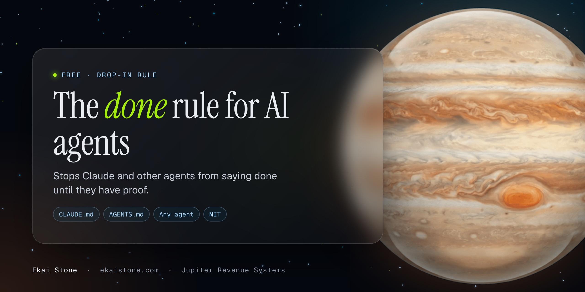

<p align="center"></p>

# The done rule for AI agents

**Your AI agent says "done." Is it?** This is a drop-in rule that stops Claude (and any other coding or ops agent) from calling work finished, live, fixed or checked until it has proof from the real result.

I run a company on AI agents. The most expensive thing one ever did wasn't a bug. It was the word "done" on work that wasn't. A false "done" costs money, clients and trust, and it's the most common way agents fail in real work. This rule fixed it for us.

## What it does

- The agent names the **scope** of every status claim, so "these 7 fixes are live" can't pass for "the job's finished."
- It builds an **inventory** (one row per ask, from every source) before it calls a job complete.
- It only counts **live evidence**: what it saw or measured on the real thing, not "I wrote the code" or "a subagent said so."
- It gets an **independent check** from a fresh agent on client work.
- It reports in **three parts**: X of Y done, what's open, what it didn't check.
- It says **"not checked"** instead of rounding up, and corrects itself right away.

## Install (1 minute)

**Claude Code, every project:** add the contents of [`CLAUDE.md`](CLAUDE.md) to `~/.claude/CLAUDE.md`.

```bash
curl -fsSL https://raw.githubusercontent.com/jupiter-revenue-systems/claude-done-rule/main/CLAUDE.md >> ~/.claude/CLAUDE.md
```

**One project only:** add it to that project's `CLAUDE.md` instead.

**Codex, Cursor, Gemini CLI and other agents:** use [`AGENTS.md`](AGENTS.md) (same rule) in your project root.

**ChatGPT, Claude.ai or Gemini chat:** paste [`RULE.md`](RULE.md) into your custom instructions or project instructions.

## The rule

The full text is in [`RULE.md`](RULE.md). The short version:

> Never say or imply done, finished, complete, live, checked, verified, fixed, "all", or "only X left" unless it's backed by a live check, for exactly the scope the sentence covers.

## Before and after

**Before:**
> All revisions are done and the site is live!

**After:**
> 41 of 44 revisions are live, checked in Chrome at 375 and 1440 wide.
> Open: #12 (needs the client's new logo), #30 and #31 (the form still posts to the old address).
> Not checked: Safari, and the confirmation email.

## Templates

- [`templates/INVENTORY.md`](templates/INVENTORY.md): one row per ask, with status and evidence.
- [`templates/COMPLETION_REPORT.md`](templates/COMPLETION_REPORT.md): the three-part report.

## Want it enforced, not just asked for?

A rule asks. Code checks. The **Feedback Loop Skill** is the code and Claude skill behind my agent feedback loop: plan, do, check, fix and score, in any part of your business. It's an add-on to the [HOPS Team](https://ekaistone.com/hops).

## License

MIT. Use it, fork it, put it in your own agents.

---

Built by [Jupiter Revenue Systems](https://ekaistone.com). Star the repo if it helps.
